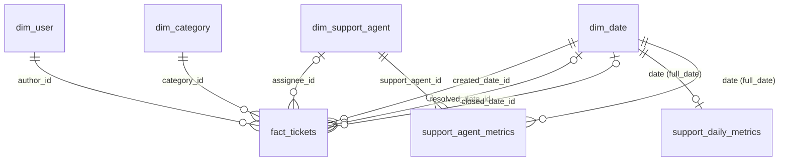

# Аналитическая модель HelpDesk — спринт 2

Основание: план спринта 2 (раздел Data Engineer), API-документация
(разделы 8.3–8.5), техническое задание (раздел 8).

DDL: `migrations/V1__analytics_schema.sql`. Скрипт предназначен для отдельной
аналитической PostgreSQL, предоставленной DevOps. Он создаёт схему `analytics`
и семь таблиц; его нельзя включать в Flyway backend, работающий с operational БД.
Развёртывание БД и настройка подключений относятся к DevOps. Загрузка данных
через Airflow и расчёт витрин выполняются в последующих спринтах.

## ERD

## Измерения

`dim_user`: одна строка на пользователя, `user_key` — технический PK,
`user_id` — уникальный UUID источника; `display_name`, `role`, `enabled` —
текущее имя, роль и доступность. `source_created_at`, `source_updated_at` —
временные метки источника, `loaded_at` — время загрузки в аналитику.

`dim_support_agent`: одна строка на сотрудника SUPPORT/ADMIN;
`support_agent_key` — технический PK, `user_id` — уникальный UUID источника.
Остальные поля аналогичны `dim_user`. Исторические сотрудники должны сохраняться
после отключения; политику смены роли необходимо определить при реализации ETL.

`dim_category`: `category_key` — технический PK, `category_id` — уникальный UUID
категории; `code`, `name`, `active` — код, название и активность;
`source_created_at`, `source_updated_at`, `loaded_at` — временные метки.

Измерения содержат текущее состояние (SCD Type 1); история версий не реализована.
Связи факта используют уникальные UUID источника, а не технические identity-ключи.

`dim_date`: `date_id` — PK в формате YYYYMMDD, `full_date` — календарная дата;
`day_of_month` — день месяца, `day_of_week` — ISO-день недели (1–7),
`day_name` — название дня, `week_of_year` — ISO-неделя, `month_number`,
`month_name`, `quarter`, `year` — месяц, квартал и календарный год;
`is_weekend` — выходной, `is_holiday` — праздник по отдельно заданному календарю.
Строка с ключом 0 и NULL в full_date зарезервирована для неизвестной даты.
CHECK проверяет соответствие остальных ключей календарной дате (годы 1–9999).
Календарь заполняет ETL;
значение is_holiday по умолчанию FALSE не является производственным календарём.

## Факт заявок

`fact_tickets`: одна строка текущего состояния на заявку; `ticket_id` — PK
и UUID источника для upsert без дубликатов.

| Поля | Значение |
|---|---|
| `author_id`, `assignee_id`, `category_id` | Ссылки на UUID соответствующих измерений; исполнитель может отсутствовать |
| `created_date_id` | Дата создания, обязательная ссылка на календарь |
| `resolved_date_id`, `closed_date_id` | Даты решения и закрытия; NULL до соответствующего события |
| `priority`, `status` | Текущий приоритет и статус, значения совпадают с operational-моделью |
| `resolution_time_seconds` | Длительность от создания до решения в секундах; NULL до решения |
| `source_created_at`, `source_updated_at` | Временные метки источника; обновление используется для инкремента |
| `resolved_at`, `closed_at` | Точное время решения и закрытия |
| `loaded_at` | Время загрузки строки в аналитику |

Сначала загружаются измерения и даты, затем факт. Между двумя БД внешних ключей нет.
Факт не хранит все переходы: для исторических назначений, переоткрытий и смены
категории/приоритета будущий ETL должен использовать `ticket_history`.
Текущее состояние факта само по себе не восстанавливает ежедневную историю очереди.

## DDL витрин

Витрины представлены таблицами для заполнения будущими DAG, а не вычисляемыми VIEW.
Поле `date` имеет тип DATE и ссылается на уникальное `dim_date.full_date`.
Витрины не допускают неизвестную дату. `support_agent_id` ссылается на
`dim_support_agent.user_id`, поэтому сотрудник должен быть загружен до его метрик.

| Таблица / гранулярность | Поля |
|---|---|
| `support_daily_metrics`: одна строка на дату | `tickets_created`, `tickets_resolved`, `tickets_closed` — количества созданных, решённых, закрытых; `open_tickets` — открытые; `critical_tickets` — критические; `avg_resolution_time_seconds`, `median_resolution_time_seconds` — среднее и медиана времени решения; `calculated_at` — время расчёта |
| `support_agent_metrics`: одна строка на дату и `support_agent_id` (UUID сотрудника) | `assigned_count`, `resolved_count` — назначения и решения; `active_tickets` — активные заявки; `avg_resolution_time_seconds` — среднее время решения; `calculated_at` — время расчёта |

Количество неотрицательное, длительности NULL при отсутствии наблюдений.
Часовой пояс суток, момент снимка очереди, состав открытых статусов, трактовка
critical_tickets, повторных решений и attribution при переназначении в документах
не определены полностью. Эти правила нужно согласовать до реализации расчётов;
DDL не выдаёт предположения за утверждённые бизнес-правила.
